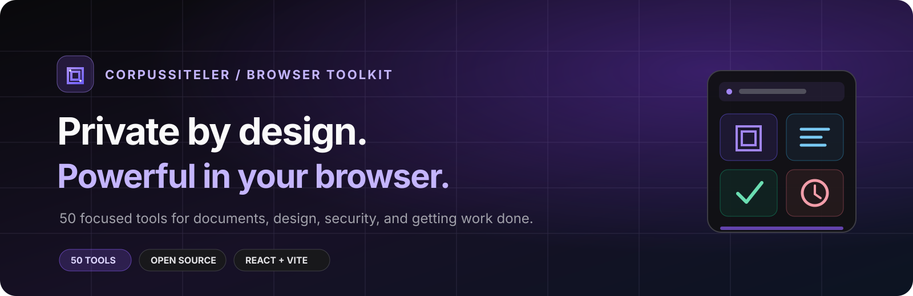
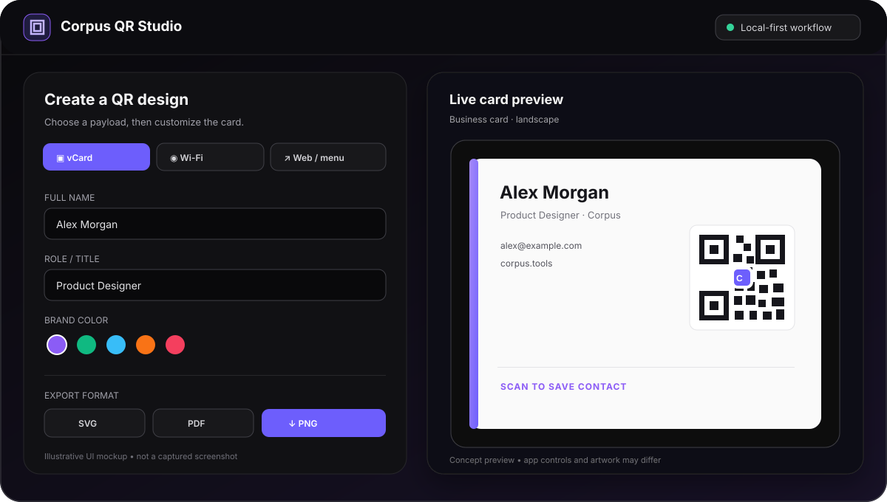

<div align="center">



# CorpusSiteler

### 50 tools. One browser. Your workflow, your way.

Free, privacy-minded tools for PDFs, documents, design, security, productivity, and development.

[🇹🇷 Türkçe](#-türkçe) · [🇬🇧 English](#-english) · [Explore tools](#-tool-directory) · [Get started](#-quick-start)

[](LICENSE)


**Open source · No account required · Built with React, TypeScript, and Vite**

</div>

---

## 🇹🇷 Türkçe

CorpusSiteler, günlük işler için **50 bağımsız tarayıcı aracını** tek bir depoda buluşturur. PDF düzenlemeden QR tasarımına, OCR’dan proje yönetimine kadar ihtiyacınız olan aracı seçin ve kendi klasöründe çalıştırın.

### Neden Corpus?

| 🔐 Gizliliği önemser | 🧰 İhtiyacına göre seç | ⚡ Modern web teknolojileri |
|---|---|---|
| Uygulamalar istemci tarafında çalışacak şekilde tasarlanmıştır. Veri akışı araca göre değişebileceğinden hassas bilgilerde ilgili aracı ve izinleri kontrol edin. | Her `corpus-*` klasörü ayrı bir uygulamadır; tüm koleksiyonu çalıştırmak zorunda değilsiniz. | React, TypeScript, Vite ve Lucide ile geliştirilmiştir; MIT lisanslıdır. |

### Öne çıkan araçlar

- **PDF Studio** — PDF düzenleme, imza, filigran, sayfa sıralama, birleştirme ve ayıklama; ayrıca yaygın belge ve görsel formatlarından PDF oluşturma.
- **QR Studio** — vCard, Wi-Fi, web, WhatsApp, IBAN ve konum QR’ları; canlı önizleme ve PNG, SVG, PDF çıktısı.
- **Günlük iş akışları** — OCR, görsel ve ses araçları, parola kasası, P2P dosya aktarımı, geliştirici araçları, finans ve proje yönetimi.

> **Gizlilik notu:** Araçların özellikleri ve veri işleme biçimi farklılık gösterebilir. Hassas verilerle kullanmadan önce ilgili aracın davranışını ve tarayıcı izinlerini inceleyin. P2P aktarım özelliği başka bir cihazla bağlantı kurar.

### 🖼️ Arayüz önizlemesi

<p align="center">
  
</p>

<sub>Temsili arayüz görseli — çalışan uygulamadan alınmış ekran görüntüsü değildir. Gerçek ekran görüntüsü eklendiğinde bu görsel güncellenebilir.</sub>

## 🇬🇧 English

CorpusSiteler brings **50 independent browser tools** together in one repository. Pick a tool for PDFs, QR design, OCR, productivity, and more—each app lives in its own folder and runs independently.

### Built for practical work

| 🔐 Privacy-minded | 🧰 Pick what you need | ⚡ Modern stack |
|---|---|---|
| Apps are designed to run client-side. Data handling can vary by tool, so review its behavior and permissions before using sensitive information. | Every `corpus-*` directory is a separate app; you don't need to run the whole collection. | Built with React, TypeScript, Vite, and Lucide. Released under the MIT license. |

### Featured tools

- **PDF Studio** — edit and sign PDFs, add watermarks, organize, merge, or extract pages, and create PDFs from common document and image formats.
- **QR Studio** — create vCard, Wi-Fi, URL, WhatsApp, IBAN, and location QR codes; preview designs and export PNG, SVG, or PDF.
- **Everyday toolkit** — OCR, image and audio apps, a password vault, P2P file transfer, developer utilities, finance, and project planning.

> **Privacy note:** Capabilities and data handling vary by app. Check the relevant app's behavior and browser permissions before using sensitive data. P2P transfer connects to another device.

### 🖥️ Interface preview

<p align="center">
  
</p>

<sub>Illustrative interface mockup, not a screenshot captured from the running app. Replace it with a real screenshot when one is available.</sub>

## 🚀 Quick start

Clone the repo, then run an app from its own directory:

```bash
git clone https://github.com/corpusproject/CorpusSiteler.git
cd CorpusSiteler/corpus-pdf
npm install
npm run dev
```

Swap `corpus-pdf` for any app directory in the [tool directory](#-tool-directory). For a production build, run `npm run build` in that app folder; Vite writes the output to `dist/`.

## 🎬 Demo

- **PDF Studio:** start `corpus-pdf`, open the PDF editor, then choose **Örnek PDF Aç** to try the sample document.
- **QR Studio:** start `corpus-qr` and use the mode controls to preview vCard, Wi-Fi, web, WhatsApp, IBAN, or location QR designs.

These demos run locally in your browser; no separate hosted demo URL is currently listed in this repository.

## 📲 Install

Apps with install support can be added from a compatible browser using its **Install app** or **Add to Home Screen** option. Availability depends on the individual app, browser, and deployment origin. You can also use any app locally with the quick-start steps above.

## 🧰 Tool directory

| Category | Apps |
|---|---|
| 📄 **Documents & office** | [PDF](corpus-pdf) · [Scan / OCR](corpus-scan) · [CV](corpus-cv) · [Invoice](corpus-invoice) · [Contract](corpus-contract) · [Sign](corpus-sign) · [Label](corpus-label) · [Certificate](corpus-cert) |
| 🎨 **Media & design** | [Audio](corpus-audio) · [Image](corpus-image) · [Screen studio](corpus-screen) · [Mockup](corpus-mockup) · [Infographic](corpus-infographic) · [Brand](corpus-brand) |
| 🔐 **Security & privacy** | [Vault](corpus-vault) · [Privacy](corpus-privacy) · [Pentest](corpus-pentest) · [Audit](corpus-audit) · [P2P transfer](corpus-transfer) |
| 🧑‍💻 **Developer tools** | [DevTools](corpus-devtools) · [Diff](corpus-diff) · [Schema](corpus-schema) · [Load test](corpus-loadtest) · [i18n](corpus-i18n) · [QR](corpus-qr) · [Prompt](corpus-prompt) |
| 📊 **Projects & work** | [Gantt](corpus-gantt) · [Kanban](corpus-kanban) · [Mind map](corpus-mind) · [Events](corpus-event) · [Pitch](corpus-pitch) · [Cap table](corpus-captable) · [RFP](corpus-rfp) · [Postmortem](corpus-postmortem) |
| 💰 **Finance & analytics** | [Calculator](corpus-calc) · [Credit](corpus-credit) · [Payroll](corpus-payroll) · [Pricing](corpus-pricing) · [BI](corpus-bi) · [A/B test](corpus-abtest) |
| 🌍 **Operations & sustainability** | [Fleet](corpus-fleet) · [Logistics](corpus-logistics) · [OEE](corpus-oee) · [Energy](corpus-energy) · [Carbon](corpus-carbon) · [Cloud](corpus-cloud) · [Patent](corpus-patent) |
| 📣 **Marketing** | [SEO](corpus-seo) · [Social](corpus-social) |

## ❓ FAQ

<details>
<summary><strong>Do I need to install anything to use the tools?</strong></summary>

For local development, install Node.js and npm, then follow the quick-start steps. End users can use deployed browser apps without installing a package; compatible apps may also offer browser-based installation.
</details>

<details>
<summary><strong>Do the apps upload my files?</strong></summary>

Apps are designed around client-side processing, but behavior depends on the specific tool. Review that app's implementation and permissions before handling sensitive files. P2P transfer necessarily communicates with a receiving device.
</details>

<details>
<summary><strong>Can I run only one tool?</strong></summary>

Yes. Each app has its own folder and `package.json`. Run the commands from that app's directory.
</details>

<details>
<summary><strong>Where can I see a live demo?</strong></summary>

No hosted demo link is currently configured in this repository. Run an app locally using the quick-start instructions above.
</details>

## 🤝 Contributing

Bug reports, ideas, and pull requests are welcome. [Open an issue](https://github.com/corpusproject/CorpusSiteler/issues) to start a discussion.

## 📄 License

[MIT](LICENSE)

<div align="center">

**Built for useful work, with privacy in mind.**

⭐ If CorpusSiteler helps you, please star the repository. ⭐

</div>
